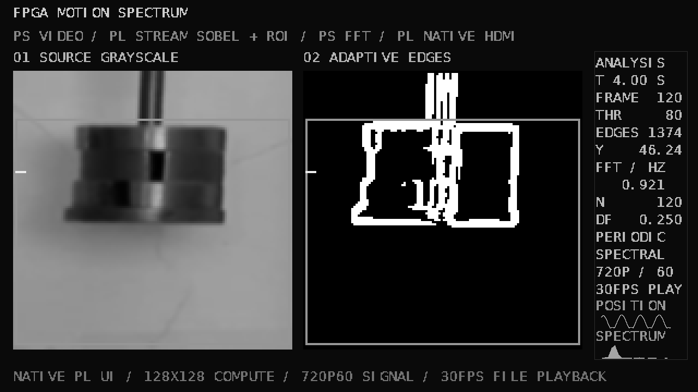
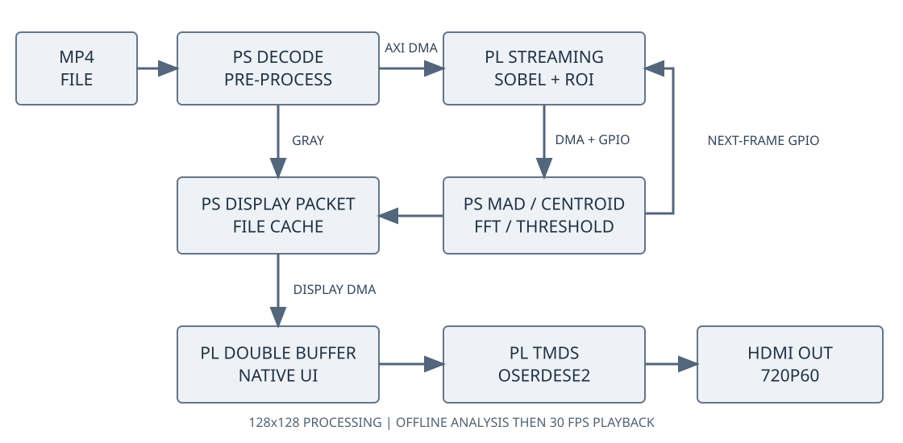

# 运动频谱的自适应边缘检测系统

基于 PYNQ-Z2 的离线视频处理与运动分析系统。PS 完成视频解码、运动特征与 FFT 分析，PL 完成流式 Sobel、ROI 统计和 HDMI 界面生成。处理完成后，以 30 FPS 播放原始灰度图、处理结果、ROI、位置曲线及频谱。

当前算法分辨率为 **128×128**，HDMI 信号为 **1280×720 / 60 Hz**，可接入支持该输入模式的 1920×1080 显示器。30 FPS 是缓存播放帧率，不是压缩视频的端到端处理速度。摄像头采集未纳入正式版本。



上图根据真实板测输出的显示数据包在电脑端还原，不是显示器实拍照片。演示视频和作品照片后续补充。

## 架构



## 目录

| 目录 | 内容 |
|---|---|
| `src/rtl` | 当前 Verilog：流式 Sobel、双缓冲、布局、字体、时序、TMDS 与串行器 |
| `src/ps` | 已板测的 PS 驱动、阈值策略、频率估计、显示数据包与播放器 |
| `src/constraints` | PYNQ-Z2 引脚和时序约束 |
| `src/history` | 信号/FFT、PS/PL、HDMI 彩条、摄像头试验及旧视频方案的历史源码 |
| `sim/benches` | 六项 RTL 测试平台、13 项软件测试及测试向量 |
| `build` | 构建入口、板卡定义、源码快照、实现与时序报告 |
| `board/overlay` | 已验证的 bit、hwh 与配套清单 |
| `board/results` | 原始板测指标、逐帧 CSV、软件快照与校验结果 |
| `board/packages` | 已在板卡新目录验证的独立运行 ZIP |
| `data/input` | 公开视频、预处理输入、受控测试输入、字体及来源信息 |
| `data/evidence` | 原始数组的无损压缩档案和 SHA-256 清单 |
| `skill` | 通用 Overlay/DMA 检查、参考比对、两类任务与排错流程 |
| `report` | 设计报告、优化数据、大模型协作记录及复现说明 |

仓库目录与文件采用小写英文、数字、下划线或连字符；文档入口统一为 `readme.md`。构建入口会在 Git 忽略的工作目录恢复旧运行时所需的厂商目录名和字体名，已验证的 RTL 与 PS 主程序保持原字节内容。按指南推荐结构组织，`readme.md` 对应其 README 入口。

## 已验证的主要结果

| 项目 | 旧视频基线 | 当前版本 |
|---|---:|---:|
| BRAM Tile / 140 | 136.5（97.50%） | 37（26.43%） |
| LUT | 4354 | 4500 |
| FF | 6381 | 6345 |
| DSP | 0 | 0 |
| WNS / ns | 0.885 | 2.048 |
| WHS / ns | 0.006 | 0.018 |
| CDC Critical 行数 | 1 | 0 |
| 151 帧离线全流程 / s | 52.12 | 26.23 |
| PS 界面生成均值 / ms | 78.87 | 6.83 |

全流程包括处理、参考校验、界面准备和缓存写入，变化来自多个环节，不能视作单独的 PL 加速比。同板优化 OpenCV 的 Sobel＋ROI 为 5.10 ms，PS＋PL 为 4.69 ms，后者包含 DMA、主机和驱动开销。完整原视频处理多次约 26～28 秒，约 5.4～5.8 FPS。

受控噪声场景中，固定阈值、时域反馈、无 FFT 的空间策略、频谱反馈策略的平均 F1 分别为 0.167、0.292、0.447、0.619。采用 1 像素匹配容差，统计预热后 235 帧。其他场景不一定有优势，完整结果见 [算法对照](report/metrics/board_algorithm_scores.json) 和 [设计报告](report/design_report.md)。

最终长测完成 18,120 帧，平均 30.0000 FPS，帧间隔 P95 为 33.49 ms，最大约 50.07 ms，超期重排 0 次。该结果来自显示端硬件握手及计数器，不能替代显示器观感检查。[完整测量口径与证据](report/metrics/upgrade_metrics.json)

## 电脑端检查

Python 3.10 或更高版本。先建立虚拟环境并安装电脑依赖：

```powershell
python -m venv .venv
.\.venv\Scripts\python.exe -m pip install -r requirements.txt
.\.venv\Scripts\python.exe build/reproduce.py check
.\.venv\Scripts\python.exe build/reproduce.py verify-evidence
.\.venv\Scripts\python.exe build/reproduce.py recheck --run final_gc_release
```

`check` 不会访问板卡；正常输出 13 项软件测试通过、两类 Overlay 配置检查通过。`verify-evidence` 校验所有压缩档案及原始字节哈希。`recheck` 恢复最终板测原始数组，逐像素重新计算 Sobel 与 ROI，核对显示缓存及软件快照。

## Vivado 构建与仿真

实测工具为 Vivado 2024.2，目标器件 `xc7z020clg400-1`。指南推荐 2026.1 或 2025.2；这里保留已完成实现和板测的 2024.2 工程，并提供同版本构建脚本。其他工具版本尚未验证，不在报告中写成已通过。

建议将仓库放在较短路径，例如 `C:/fpga/hlstrack2026_47433`。将下面的工具路径替换为自己的安装路径：

```powershell
python build/reproduce.py simulate --vivado 'D:/Xilinx/Vivado/2024.2/bin/vivado.bat'
python build/reproduce.py hardware --vivado 'D:/Xilinx/Vivado/2024.2/bin/vivado.bat'
```

仿真入口检查六项测试。`hardware` 依次创建 Block Design、综合、实现、检查 setup/hold 和 DRC，并导出配套硬件。完整顺序可用 `all`。生成工程位于 `build/work/runtime/build/award_video/award_video.xpr`，新硬件位于 `build/work/runtime/out`，不会覆盖仓库中的已验证预编译文件。

## PYNQ 上运行

已验证环境：PYNQ-Z2、PYNQ 3.0.1、Python 3.10.4、NumPy 1.21.5、OpenCV 4.5.4、Pillow 9.0.1。PYNQ 由板卡镜像提供，不要在 Windows 安装 PYNQ 来代替板端环境。

1. 摄像头不接入，HDMI 连接板卡 **HDMI OUT** 与显示器，选择相应输入源。
2. 将 `board/packages/award_video_runtime.zip` 上传到板卡 Jupyter 并解压，进入解压得到的 `award_upgrade` 目录。
3. 打开 `01_run_demo.ipynb`，依次运行检查格和演示格。先处理 151 帧，再播放三遍并自动黑屏。
4. 提前结束可中断执行；需要从另一 Notebook 停止时，在同目录运行 `%run black_screen.py`。

如果上传的是完整仓库，可打开 `board/demo.ipynb`。它先建立兼容运行目录，再调用同一套已验证程序。命令行入口为 `python3 board/run_demo.py --loops 3 --decoder opencv`；输出位于 `build/work/runtime/results`。构建后的新版硬件需要自己重新完成板测，不应与旧硬件的已通过状态混用。

## 文档与记录

- [完整设计报告](report/design_report.md)；[PDF 版](report/design_report.pdf)
- [逐步复现](report/reproduction.md)
- [开发过程与版本边界](report/development_history.md)
- [大模型协作与纠错索引](report/llm_collaboration.md)；[脱敏公开消息记录](report/llm/transcript_redacted.jsonl)
- [通用 PYNQ 技能包](skill/readme.md)
- [GitHub 上传步骤](github_upload_steps.md)
- [来源与许可](third_party.md)

开发中使用大模型协助方案讨论、代码修改和排错。协作记录保留真实的用户提示词、公开回答与阶段性纠错；最终结论以原始测试数据和可执行检查为依据。未伪造提交历史或人工测试记录。

自写代码采用 MIT 许可。公开视频及其派生数据、字体和厂商板卡资料按各自许可处理，具体见来源清单。未收入厂家教学 PDF、安装工具、个人账户信息和 Vivado 缓存。
