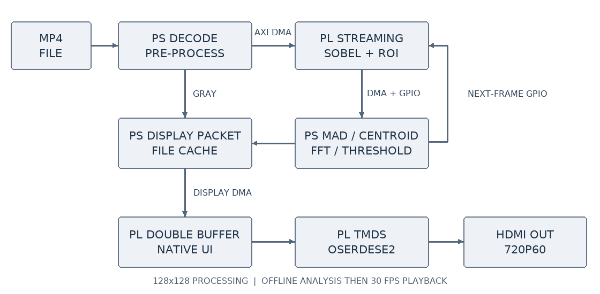
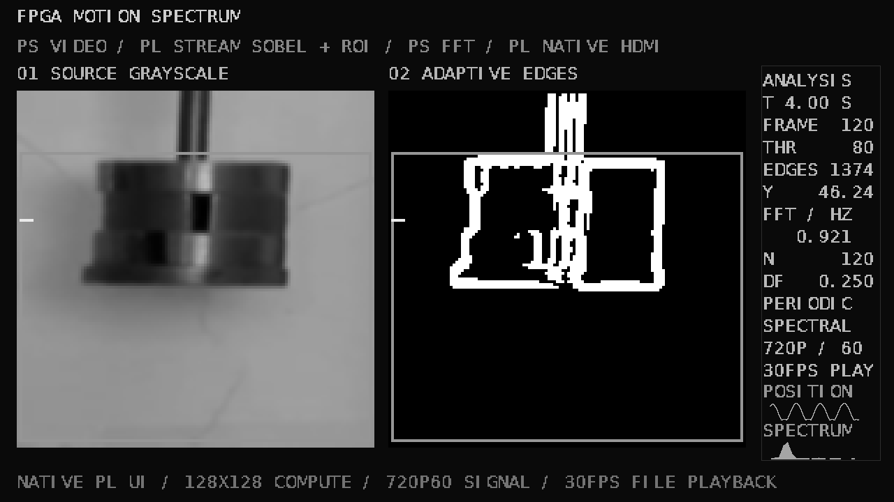

# 运动频谱的自适应边缘检测系统

设计与验证报告 · 自主选题高级组 · 2026-11-03

## 1. 摘要

本作品在 PYNQ-Z2 上实现离线视频的图像处理、运动分析与 HDMI 展示。PS 完成视频解码、灰度预处理、运动强度统计、频谱分析和阈值决策；PL 完成流式 Sobel、阈值处理、ROI 边缘计数及纵坐标和，并原生生成图像、字符与曲线界面。输出分为两个阶段：先处理完整视频并保存逐帧结果，再以 30 FPS 播放显示数据包。当前算法分辨率为 128×128，输出信号为 720p60。

针对原有方案 BRAM 占用接近上限、PS 画布生成耗时较高的问题，本轮将整帧重复邻域读取改为两行缓存与窗口复用，并把完整画布传输改为图像和元数据传输。实现后 BRAM 从 136.5 Tile 降到 37 Tile，WNS 从 0.885 ns 提高到 2.048 ns。同日 151 帧全流程对照由 52.12 秒降到 26.23 秒。最终 10 分钟测试完成 18120 帧，平均 30.0000 FPS，超期重排为零。

本报告同时保留算法无优势的场景、两次长测停顿和后续纠错，不将单次优良结果扩大为所有视频或所有板卡的结论。视频录制不在本轮整理范围内。

## 2. 需求与功能范围

课题关注动态场景中的边缘提取、运动序列分析和软硬件协同实现。早期工作已完成采样、FFT、PS/PL 控制、缓存读回与参考比对。后续尝试将 OV5640 作为输入，但未形成稳定实时更新的证据，因此正式需求改为视频文件输入。当前交付不依赖摄像头，也不把摄像头试验计入已完成的功能。

| 项目 | 当前实现 |
|---|---|
| 输入 | 公开弹簧振子 MP4、已准备的灰度帧或受控测试 NPZ |
| 算法输入 | 128×128，8 位灰度 |
| PS | 解码、裁剪、灰度化、缩放、Gaussian 3×3、MAD、FFT、阈值、结果管理 |
| PL | Sobel、阈值、ROI 统计、显示缓存、原生布局、TMDS 串行输出 |
| 播放 | 处理完成后的 30 FPS 缓存播放 |
| HDMI | 1280×720、60 Hz；显示器原生 1920×1080 |
| 图像识别范围 | ROI 边缘统计与质心代理，不是通用目标分类网络 |
| 不在当前范围 | 摄像头实时采集、1080p 原生输出、PL FFT、端到端 30 FPS 解码处理 |

128×128 是算法分辨率，720p 是输出时序，30 FPS 是内容更新率，三者不混用。原视频单次处理仍约 26～28 秒，即 5.4～5.8 FPS。显示器观感需要现场观察，本报告的长测结果来自硬件握手和计数器。

## 3. 平台与继承基础

平台为 PYNQ-Z2，器件为 xc7z020clg400-1。板端为 PYNQ 3.0.1、Python 3.10.4、NumPy 1.21.5、OpenCV 4.5.4 和 Pillow 9.0.1。已使用 Vivado 2024.2 完成仿真、综合、实现及干净目录构建。指南推荐较新的工具版本；本工程保留已经完成板测的工具版本，并交付可执行构建入口与版本说明。未把其他版本写成已验证。

毕业设计阶段的样本缓存、PS 读回、寄存器控制和 FFT 校验构成控制与验证基础；图像与运动分析部分承接新苗项目的方向。本轮新增工作集中在窗口复用、原生显示、策略消融、长测和可复用验证工具。Sobel、FFT 和 TMDS 本身均为已有方法，不宣称这些基础算法由本作品首创。

历史代码按功能保存在 src/history。历史文件的公开副本可能因路径脱敏或编码转换而改变哈希；当前正式 RTL、PS 主程序和预编译硬件与已验证版本保持原字节，兼容工作目录通过映射恢复。

## 4. 总体架构与软硬件划分

数据从视频文件进入 PS，预处理后形成 128×128 灰度图。PS 经 AXI DMA 把图像送入 PL，PL 返回二值边缘及饱和幅值，同时通过 GPIO 提供 ROI 计数与纵坐标和。PS 据此产生位置序列、运动强度和频谱特征，决定后续帧阈值；显示侧只传图像和结构化元数据，文字、边框、放大及曲线由 PL 完成。

图 1：正式版本的数据与控制通路。反馈参数作用于后续帧，显示链路使用独立 DMA 与双缓冲。

分工依据是运算频率和可变性：像素邻域运算、扫描与串行输出适合固定数据通路；视频文件解析、策略试验和频谱估计先保留在 ARM，便于与毕业设计基础衔接及独立检查。当前没有为了增加硬件功能而强行把 FFT 移入 PL。

PS FCLK0 为 100 MHz。Clocking Wizard 生成 74.25 MHz 像素时钟和 371.25 MHz 串行时钟，OSERDESE2 以 DDR 方式输出。视频总时序为 1650×750，有效区为 1280×720。

图 2：由真实板测显示数据包在电脑端还原的画面。包含灰度原图、边缘结果、ROI、质心、阈值、频率、位置和频谱；不作为显示器实拍图。

## 5. 数据格式与寄存器接口

Sobel 输入每个像素占一个 uint32，灰度位于低 8 位，其余位为零。一个 128×128 图像传输 65536 字节。输出同样每像素一个 uint32，低 8 位为 0/255 二值结果，15:8 为饱和幅值，高 16 位为零。每帧 TLAST 只在最后一个字有效，TKEEP 为 0xf。

| IP | 当前地址 | 作用 |
|---|---|---|
| axi_dma_0 | 0x40400000 | Sobel 输入与返回数据 |
| display_dma | 0x40410000 | 显示数据包发送 |
| axi_gpio_ctrl | 0x41200000 | 复位、启动、阈值和加速器状态 |
| axi_gpio_roi | 0x41210000 | ROI 坐标 |
| axi_gpio_stats | 0x41220000 | ROI 边缘数和纵坐标和 |
| display_control | 0x41230000 | 显示使能、时钟/HPD、换帧计数和协议错误 |

控制字 bit0 为运行复位释放，bit1 为上升沿启动，15:8 为阈值。状态高四位为 0xd，27:24 为循环帧号，23:20 为错误码，bit1 为 busy，bit0 为 done。ROI 打包为 x0、y0、x1、y1 四个字节，采用左闭右开范围。

ROI 统计通过双通道 GPIO 返回：偏移 0 为边缘数量，偏移 8 为纵坐标和。质心为 y_sum / count，count=0 时标记缺失，不以零位置填充。

显示 GPIO 高字节为 0xa8，23:8 为已提交帧计数，低位包含协议错误、pending、已有帧、心跳、HPD、复位释放、时钟锁定与使能。软件等待帧计数和 DMA 状态共同完成，避免把发送完成当作已经换帧。

## 6. 图像处理与阈值策略

预处理按实际 PS 实现记录：读取视频、裁剪、灰度化、缩放到 128×128、Gaussian 3×3。没有把这些功能误写为当前 PL 实现。Sobel 计算水平与垂直梯度，使用 L1 幅值并饱和到 255。

`magnitude = min(abs(gx) + abs(gy), 255)`

`edge = 255 if magnitude >= threshold else 0`

图像外一像素边界强制为零，阈值为零时也不输出边界。ROI 统计只累加实际输出握手成功且位于 ROI 的边缘像素。

共有五个策略名。fixed 为固定阈值；time 直接根据历史 MAD 均值反馈；spectral_v1 是旧频谱反馈基线；spatial 为新的梯度/对比度策略；spectral 在 spatial 的相同结构上增加频谱因子。去掉 FFT 的 spatial 组用于隔离频谱因子的贡献，不能只通过 fixed 与 spectral 的差异断言全部提升来自 FFT。

MAD 是 ROI 内当前灰度图与前一帧的平均绝对差，用作场景变化和噪声线索。谱反馈取最近 64 个 MAD 样本，减均值、加 Hann 窗、计算功率谱，统计不低于 0.2×采样率的高频功率比例。30 Hz 输入下分界为 6 Hz。该比例不是单摆的位移频率。

新的阈值目标同时考虑梯度中位数和高梯度 99 分位值。当高梯度已超过基础阈值时保留基础对比度目标，不因图像整体变暗直接降低阈值。噪声项由 2.2 倍梯度中位数构成；spectral 再乘以 1＋0.65×高频比例。目标限幅 20～200，经 0.25 的平滑系数和每帧最多 4 的步长限制更新。特征每四帧更新，前八个运动样本作为预热。

参数在开发集上确定后冻结，记录在 report/metrics/frozen_policy.json。保留集改变随机种子且不再调参。决定当前帧阈值时只使用此前帧的历史；当前帧处理后才更新历史，避免借用未来信息。

## 7. 位置频率估计与偏移提示

用于显示的频率来自 ROI 边缘纵坐标质心历史，而不是把 MAD 谱峰直接解释为物体频率。对有限有效后缀先线性去趋势，再加 Hann 窗做 FFT，在 0.2～5 Hz 中寻找峰值，并进行对数幅度三点插值。

当前窗口上限 512 点，最少 64 点。位移标准差太小、数据缺失、周期数不足两周期或谱峰集中度不足时，不显示有效频率。缺失位置会截断有效后缀，不能用零补齐制造频率。频谱每六个源视频帧更新一次，计算采用源视频帧率，播放帧率变化不改变其时间轴。

采样网格间隔 df=fs/N 不等于测量误差。真实视频的帧时钟没有独立标定，质心也只是像素代理，故真实视频得到的约 0.921 Hz 只作为估计值，不报告为已知真值下的精度。

系统还提供参考频率偏移提示，可由显式参考值或连续有效估计标定，并要求连续三个更新越限。合成输入从 1 Hz 变到 1.5 Hz 时，512 点窗口在约 9.37 秒后提示；它不是瞬时检测，也不将频率变化直接命名为设备故障。

## 8. 流式 Sobel 与背压处理

旧版先缓存整帧，再按像素重复访问邻域。当前版使用两行 8 位缓存和横向窗口复用，构成连续 3×3 邻域。运算拆成加权行/列和、带符号梯度、绝对值和、幅值/阈值四级弹性流水。行缓存保留在分布式存储中，减少整帧存储与重复读数。

输出被暂停时，全局 advance 信号冻结有效位、像素、边界、ROI 和坐标信息，输入 ready 同时拉低。只在输入握手后更新行缓存与窗口，只在输出握手后更新 ROI 统计。接收结束后补齐末尾边界输出，再等待最后一个输出握手完成帧事务。

六组测试覆盖真实帧、随机图、全黑、全白、阈值边界、不同 ROI、输入暂停、输出背压、TLAST 和中途复位。98304 个输出像素全部匹配。相同测试激励下平均事务周期由 171279.17 降到 25366.67，约 6.75 倍；首个输出约从 20481 周期降到 166～168 周期。这些周期包括测试平台的暂停条件，不等于用户看到的整机处理帧率。

## 9. 原生显示与跨时钟域

旧版每帧由 PS 绘制 640×360 完整灰度画布，需传输 230400 字节。当前显示包为两个 128×128 图像和 1024 字节元数据，总计 33792 字节，较旧版减少 85.33%。元数据含固定宽度 ASCII、位置曲线跨度和频谱柱高。

PL 以 4 倍最近邻放大显示两个 128×128 图像，按位置生成边框和字符，通过字体 ROM 输出字形。图像、字体、曲线和同步信号经过一致的流水延迟。完整像素仿真检查 921600 个输出像素及 DE/HS/VS 对齐，串行器另外以 UNISIM 验证。

帧缓存使用两个银行。写侧只写非显示银行，完整包长度、TKEEP 与 TLAST 正确后才发布请求；像素域只在场消隐起点换帧，并返回单比特确认。请求保持到确认完成，避免把不稳定多位银行地址直接跨域。ACK 同步与已见状态均参与 ready，防止换银行边界接受一个字到错误银行。

复位路径先在参考时钟域形成寄存输出，再同步到像素域，移除原先直接进入同步链的组合复位汇合。实现后的 CDC 报告不再有 Critical/Unsafe 项；这不表示所有工具警告都消失，也不代替板级电气验证。

## 10. 正确性验证

| 层次 | 检查 | 结果与证据 |
|---|---|---|
| 软件 | 参考与 OpenCV、一致性、有效频率、因果性、DMA 故障模拟、GC 状态恢复 | 13 项通过，sim/benches |
| RTL | 时序、编码、串行器、帧缓存、Sobel、原生布局 | 6 项通过，build/reports/optimized 与 sim/results |
| 图像原视频 | 151 帧幅值、边缘、ROI、质心逐帧核对 | 最终复核零差异，board/results/final_gc_release |
| 控制场景 | 两种输入×四种策略，每组 300 帧 | 共 2400 帧，每帧 PL 与参考一致 |
| 通用工具 | 独立直通与 Sobel 适配器 | 两类 Overlay 真实板测通过 |
| 复现 | 干净目录硬件构建、独立 ZIP 板端运行 | 结果分别单独记录 |

软件故障注入验证的是错误处理逻辑，不冒充真实板卡故障。电脑参考、仿真、板端运算、显示握手和实拍照片属于不同证据层次。仅加载 bit 成功或板上灯亮，不足以确认算法正确。

原始数组以 NPZ 无损归档；恢复后核对每个原始文件的字节数和 SHA-256。JSON、CSV 与软件快照保持可读，软件快照哈希与原始运行绑定。字段中的 NOT_RUN 或早期状态保留其当时含义，不回写伪造通过；最终状态依据对应后续板测文件判断。

## 11. 算法对照结果

受控场景采用移动矩形的已知几何内轮廓作为真值，并施加噪声、增益变化和闪烁。每序列 300 帧、30 Hz，保留集随机种子与开发集不同。精确率和召回率使用一像素 Chebyshev 容差的独立匹配，不做一对一配对。各策略统一统计 frame index≥65 的 235 帧，报告逐帧 F1 的均值。

以下完整场景表来自电脑参考保留集，不能全标为板测。五个策略的完整原始 CSV 均公开；表中节选当前四组。

| 场景 | fixed | time | spatial | spectral |
|---|---:|---:|---:|---:|
| clean | 0.8516 | 0.8516 | 0.8516 | 0.8516 |
| noise_20 | 0.1667 | 0.2919 | 0.4474 | 0.6191 |
| noise_35 | 0.0638 | 0.0974 | 0.4293 | 0.6499 |
| dim_065 | 0.8516 | 0.8626 | 0.8516 | 0.8516 |
| bright_130 | 0.8408 | 0.8408 | 0.8408 | 0.8408 |
| flicker_9hz | 0.8478 | 0.8607 | 0.8478 | 0.8478 |
| low_contrast_noise | 0.9989 | 0.9978 | 0.9971 | 0.9971 |
| weak_contrast | 0.0000 | 0.0000 | 1.0000 | 1.0000 |

真实 PL 另外验证了 noise_20 和 weak_contrast 两类输入，每类四组各 300 帧。noise_20 的 fixed/time/spatial/spectral F1 为 0.1667、0.2919、0.4474、0.6191。spectral 相对 spatial 的改善显示在这一测试条件下，频谱因子提供了增量价值。其位置 RMSE 约从 fixed 的 7.10 像素降到 spectral 的 3.65 像素。

该结论不能扩大为频率误差在所有条件下也最小：noise_20 中 spectral 的频率相对误差约 0.351%，spatial 约 0.143%，time 约 0.184%。边缘 F1 更高不必然对应某段有限窗口内频率误差更低。

干净输入、整体变亮和部分闪烁条件并未给出新频谱策略的稳定优势；这些数据完整保留。弱对比度的理想矩形中 fixed 未检出、spatial/spectral 检出，也只能说明该合成条件下的适应性，不能作为所有弱目标的性能保证。

另用六组非整频点的干净合成输入检查频率估计，0.37、0.53、0.73、1.13、1.77、2.31 Hz 的相对误差约为 0.354%、0.278%、0.202%、0.132%、0.093%、0.005%。这是给定信号与时间轴的数值检查，不是相机或机械系统的物理精度标定。

## 12. 性能与资源比较

| 指标 | 旧视频基线 | 当前版本 |
|---|---:|---:|
| LUT | 4354 | 4500 |
| FF | 6381 | 6345 |
| BRAM Tile / 140 | 136.5 / 97.50% | 37 / 26.43% |
| DSP | 0 | 0 |
| WNS / ns | 0.885 | 2.048 |
| WHS / ns | 0.006 | 0.018 |
| 151 帧全流程 / s | 52.1198 | 26.2300 |
| 解码预处理均值 / ms | 103.18 | 101.47 |
| DMA＋PL 均值 / ms | 5.90 | 4.55 |
| 参考校验均值 / ms | 11.03 | 11.34 |
| PS 界面准备均值 / ms | 78.87 | 6.83 |

节省 BRAM 的代价是 LUT 增加 146 个，属于显示布局和窗口逻辑的资源交换。全流程约 1.99 倍改善同时包含硬件、界面、缓存和调试 I/O 变化，不归因于一个 RTL 模块。解码依然约占每帧 100 ms，是原视频处理的主要限制。

同板微基准使用预先在 RAM 中准备的相同 151 帧、阈值和 ROI，各后端预热三帧，三轮交替顺序，每后端 453 次。计时仅覆盖 Sobel 幅值/二值和 ROI，排除解码、策略、界面及比对；PL 一侧包含主机、DMA 和驱动开销。NumPy 为 10.52 ms，优化 OpenCV 为 5.10 ms，PS＋PL 为 4.69 ms。与较强 OpenCV 基线比较约为 1.09 倍，而不是只展示对 NumPy 的约 2.24 倍。

报告分别给出 RTL 周期、函数微基准、全流程和播放帧率。评估接口或分工时应使用对应层次的数据，不能用 PL 时钟或缓存播放速度代替压缩视频端到端吞吐量。

## 13. 长时间播放与纠错

前两次十分钟测试都完成 18120 帧，但各发生一次超期重排。第二次已把约 5.1 MB 显示缓存预加载到 RAM，仍在第 14566 帧出现约 333.51 ms 的间隔，其中提交/等待约 315.11 ms。这说明仅排除按需读盘不能解释全部停顿。

进一步测得板上一次完整循环垃圾回收约 197 ms。当前做法是在播放前完成回收，对有限次播放暂时暂停自动循环 GC，并在退出时恢复调用者原状态。其单元测试覆盖异常退出、调用者原本关闭 GC 和无限循环保持自动 GC 的情形。这项修正改变的是循环 GC 时机，普通对象的引用计数释放仍然生效。

| 长测 | 缓存/调整 | 平均 FPS | P95 / ms | 最大间隔 / ms | 超期重排 |
|---|---|---:|---:|---:|---:|
| 初次 | 内存映射 | 29.9884 | 33.50 | 未记录 | 1 |
| 第二次 | RAM 预加载 | 29.9859 | 33.53 | 333.51 | 1 |
| 最终 | RAM＋有限播放 GC 时序调整 | 30.0000 | 33.49 | 50.07 | 0 |

最终测试的播放段没有循环 GC，退出后恢复状态；无 DMA/帧缓存协议错误。上述结果支持这一工程处理在本次工况中的效果，但没有记录到前一次停顿与 GC 事件逐条同时发生的跟踪，因此不把根因写成已严格证明，也不据此给出 Linux 平台最坏时延保证。

停止操作会写入 STOP_PLAYBACK 并关闭显示，使播放器持续退出而非下一帧重新点亮。板端联动测试在显示 12 帧后触发停止，播放器退出、画面黑屏，HDMI 时钟仍工作。之后新演示会清除上次停止标记。

## 14. 通用技能包与大模型协作

技能包位于 skill，包含配置、元数据检查、通用 DMA、结果比较、排错流程和两类示例。它只对 AXI DMA 简单模式做首版支持，不把 Sobel 寄存器绑定到通用类，也不宣称已跨另一块板卡验证。

提炼依据包括：硬件文件配对、实际字节长度、先启动接收、TLAST、接收缓存哨兵的 flush、超时状态和复位后释放。缺文件、缺 IP、长度超限、结果不一致和模拟 DMA 故障都有明确失败输出。真实直通与 Sobel 板测结果分别保存在独立目录。

开发中使用大模型协助需求拆解、Verilog 与工具脚本修改、实验设计和故障分析。报告提供 187 条脱敏公开消息，包含用户提示词、助手公开进度和最终回答；不输出系统/开发者指令、私有推理、工具参数、账户凭据或图片。原始文字只做所声明的脱敏，阶段性错误判断保留，不重写成一次成功的故事。

典型纠错包括 RAM 推断、仅按亮度降阈值造成伪边缘、频谱策略消融、长测停顿和外部 Python 环境污染。每项结论链接代码和测量依据，协作记录只是过程证据，不替代工程测试。并未生成虚假的 Git 提交历史或人工操作记录。

## 15. 构建、复现与交付

仓库按 src、sim、build、board、data、skill、report 分层，文件名采用小写英文。readme.md 作为入口。build/reproduce.py 在忽略的 build/work/runtime 中恢复已验证布局，以保留正式源程序字节与硬件配对。

电脑端执行 check、verify-evidence 和 recheck；Vivado 执行 simulate 或 hardware。构建导出使用 Python 隔离模式 -I，避免 Vivado 的 Python 环境污染。需要较短的工作路径，完整步骤见 report/reproduction.md。

预编译板端 ZIP 的 SHA-256 为 ea3a16d0f8f076a62d171335cf0487da94dbf06e1d9aef31829adcafd7cd79be。该 ZIP 已在板卡新目录独立验证：处理 151 帧、播放 453 帧、参考比对零差异，结束自动黑屏。当前目录整理没有重新虚构一次板测，依靠原字节一致性与重新执行的本机验证连接旧证据和新布局。

仓库提供 61 个原始数组文件的无损压缩档案，共 309069312 原始字节，附逐文件校验值。数据恢复与参考比对均可脚本执行。Git 忽略中间工程、波形、缓存和新运行输出；源码、预编译硬件、报告和必要参考数据保留。

视频录制按本轮要求暂不完成。作品照片和本人签署的授权材料需后续按赛事系统要求单独提交；含签名和身份信息的授权书不应公开到源码仓库。当前提供本地上传步骤，由参赛者自行创建 GitHub 公共仓库并上传，未在本轮代为发布。

## 16. 局限与后续方向

当前输入是有限文件，处理与播放是先后阶段。128×128 适合完成模块验证和展示，但不代表高分辨率视觉系统的吞吐量；720p 输出通过放大和布局产生。PS 解码仍为主要瓶颈，今后可在保持相同输出定义的前提下比较更低开销的预处理路径。

质心受到 ROI 内背景和噪声边缘影响，尚未形成多目标跟踪、遮挡处理或标定后的物理位移估计。频谱阈值反馈在部分噪声条件有效，在干净、闪烁等场景未显示普遍优势。未来应增加有标注真实视频和独立频率参考，分别验证边缘质量与运动测量，而不是只增加演示功能。

所有“已验证”均限定于对应工具、板卡、输入与测试口径。跨板卡迁移、其他工具版本、实时摄像头及更高分辨率需要重新构建和测试。

## 17. 来源与许可

自写源码采用 MIT。公开视频来自 Open Educational Resources / Open Source Physics @ Singapore 的 Spring and mass，源页面标注 CC BY-SA 4.0，派生帧与含视频画面的输出按对应条款处理。DejaVu Sans 字体、PYNQ 板卡定义及 XDC 保留其许可和出处；AMD 生成 IP 和器件库遵守原工具/IP 条款，不重新授权为 MIT。

测试数据、脚本和文档中的本机路径、网络地址及账户信息已清理。厂家教学 PDF、未经确认许可的摄像头初始化表与开发工具不收入仓库。详细链接和许可文本位置见根目录 third_party.md。
